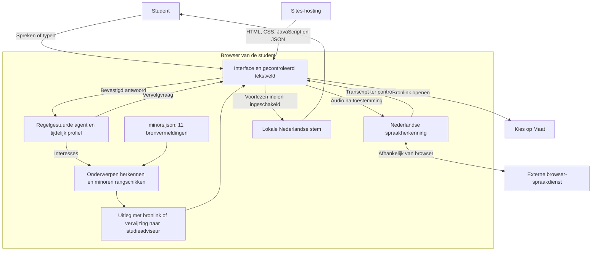

# Architectuurschets MinorKompas

## Dataverzameling
De huidige dataset is handmatig gestructureerd uit geïndexeerde Kies op Maat-pagina's. Een rechtstreekse scrape gaf HTTP 401. Het meegeleverde scrape.py controleert robots.txt en stopt bij blokkades. Een succesvolle uitvoering levert een kandidatenbestand voor handmatige beoordeling; het wijzigt de app niet automatisch.

## Grenzen
Geen eigen backend of database voor gesprekken. Profiel en antwoorden bestaan alleen in het tabbladgeheugen. Spraakherkenning kan audio extern verwerken, na afzonderlijke keuze. Voorlezen gebruikt uitsluitend een lokale Nederlandse stem. Hosting kan technische toegangslogs verwerken.

De agent is een expertsysteem met vaste vragen en trefwoorden, geen generatief taalmodel. Studieachtergrond is context, geen rankingfilter. Aanbevelingen worden alleen uit de dataset opgebouwd. Beschikbaarheid en toelating zijn niet bevestigd. Echte spraaktests en AVG-beoordeling voor productie blijven nodig.
